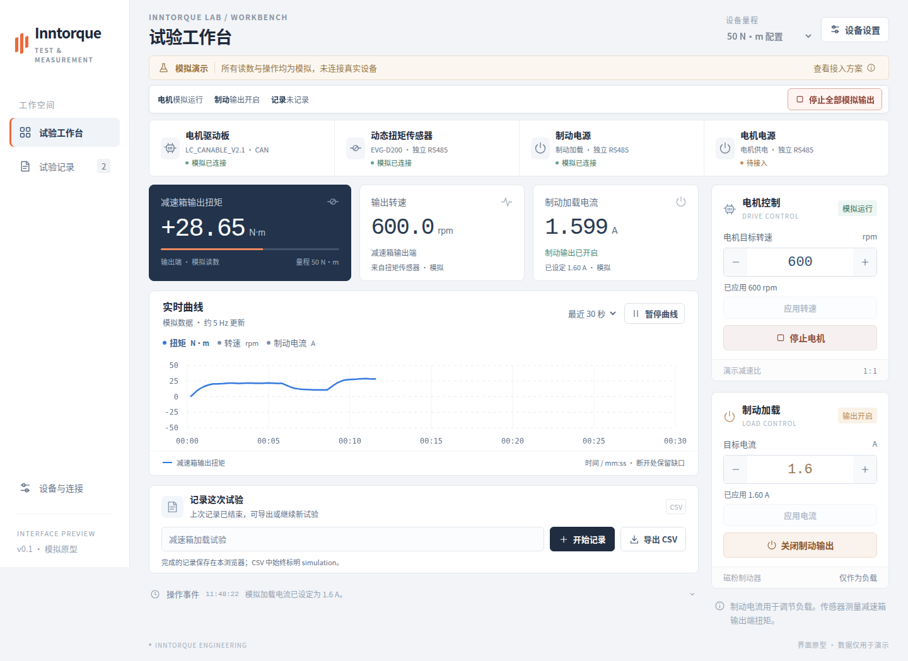

# 电机与减速箱加载试验台网页上位机

仓库：[Inntorque/motor-test-bench](https://github.com/Inntorque/motor-test-bench)（私有）。

目标：让第一次使用的人也能顺利连接试验台、读懂电机与减速箱的输出表现、记录并导出一次加载试验。

设备背景：机械链已确定为 **电机 → 减速箱 → 动态扭矩传感器 → 磁粉制动器**，磁粉制动器只提供负载。两个电源分别给电机驱动侧供电、给制动线圈供电，后者通过电流调节加载。用户现有 50 N·m、100 N·m 传感器及两种规格制动器；具体配对、是否双台同时使用及两电源型号待确认。传感器直接测得减速箱输出扭矩，不等同于电机轴扭矩。

当前阶段：已归档并研读手册，完成通信与产品需求初步梳理，并实现 React + Vite 网页交互原型。原型只使用模拟数据，不打开串口、不连接网关、不发送硬件控制命令；真实设备协议与实机联调待完成。

需求和验收状态统一见[需求基线与本轮检查](docs/requirements-review.md)，分别列明已确认设备关系、模拟验收、待协议输入和待实机验证项目。

交付方向（2026-10-09 更新）：网页版上位机，目标部署到 GitHub Pages。用户已确认 CAN 适配器为 **LC_CANABLE_V2.1**，可根据方案修改固件；计划采用 USB CDC/SLCAN + Web Serial。首轮 CAN 支持范围固定为经典 CAN 数据帧、11/29 位 ID、0–8 字节，实际速率和电机应用协议随驱动板确认。通信确定为三路独立 RS485 加一路独立 CAN：传感器、制动电源、电机电源各占一路 RS485，不共用总线，驱动板使用 CAN。独立通道可由独立适配器或多路网关的独立端口提供，硬件型号待定。传感器可经 USB-RS485，电源可经网口转 RS485；网页直连或本机/台架侧桥接按网关协议确定。当前原型在本地运行，未启用 GitHub Pages。

## 运行网页原型



需要 Node.js 22.12 或更高版本。

```sh
npm ci
npm run dev
```

打开终端显示的本地地址。页面持续显示模拟标识，首屏的“运行加载演示”可以直接体验曲线变化。原有模拟电机和制动输出默认关闭；制动电流、转速输入需点击“应用”后生效。新增电机电源仅为待接入角色，供电电压/电流显示“—”，没有设定、限流或输出开关。

- **试验工作台**：四个设备角色，减速箱输出扭矩 / 输出转速 / 实际制动电流三张读数卡，实时曲线，电机与制动电流两组控制，记录与事件。
- **运行状态**：工作台、历史页和手机滚动时都能查看输出与记录状态；“停止全部模拟输出”关闭模拟电机和制动输出，记录继续。它不代表硬件急停。未应用或无效输入会阻止启动，运行中的停止操作保持可用。断线持续提示，演示按钮不擅自恢复连接。
- **试验记录**：完成的模拟记录保存在当前浏览器，可回看扭矩、转速和制动电流，查看缺失点、开始时配置与本场操作事件，分别导出数据和事件 CSV。正在记录的数据暂存内存，页面退出前会提示；每场演示最多 1500 点，达到后自动结束记录。正式长时采集的增量存储尚未实现。
- **设备与连接**：抽屉中查看接入计划；原有 CAN、传感器、制动电源可模拟断开 / 重连，新增电机供电读回占位，待协议与功能范围确认。切换 50/100 N·m 保留连接状态，运行或记录时禁止切换。

CSV 文件名以 `SIMULATION_` 开头，每行 `source=simulation`；导出列明确区分 `gearboxOutputTorqueNm`、`gearboxOutputSpeedRpm`、`brakeCurrentA`、`motorTargetSpeedRpm`、`brakeTargetCurrentA`。每场记录的 `elapsedSeconds` 从 0 开始，`receivedAt` 单独保留电脑接收时间。原有字段名保持兼容，旧记录导出也按首点归零，不补造旧记录缺失的配置和事件。扭矩曲线保留正负方向。演示的电流范围、传动比、响应曲线不代表实际设备参数；电机供电电流也不等于电机相电流。

本地记录在读取和保存时做结构校验；发现损坏内容时保留原始存储并暂停覆盖，新记录仍可在当前页导出。支持 Web Locks 时，多标签页在同一保存锁中读取最新列表并合并，避免互相覆盖；不支持时提示只使用一个页面记录。本地配额不足或存储被其他页面清除时会明确提示未保存状态。

## 构建与验证

```sh
npm run build
npm test
```

构建只输出 `web/` 的网页资源至 `dist/`，不包含设备手册、工程文档或试验记录；使用相对资源路径，适合 GitHub Pages 项目子路径。后续发布时选择 `dist/` 为站点产物，保留源码仓库当前私有设置。

浏览器流程验证使用独立临时浏览器配置。先启动开发服务器，再运行：

```sh
npx playwright install chromium
npm run test:ui
npm run test:requirements
```

也可通过 `CHROME_PATH` 指向已有 Chrome 可执行文件，`TEST_URL` 指定测试地址。基础测试覆盖暂停曲线继续记录、断线缺口、输入应用、量程切换、CSV 导出、记录恢复及四种视口宽度；需求回归另外覆盖未应用输入、全局停止、负扭矩、事件导出、损坏记录保护和多标签页保存。截图写入被忽略的 `output/`。

源文件：`web/src/App.jsx` 为界面与交互，`web/src/styles.css` 为响应式布局，`web/src/model.js` 为纯模拟模型，`web/src/records.js` 负责记录校验、合并与本地保存。真实接入按 CAN、传感器、制动电源、电机电源分别适配；电机电源功能范围待确认，不将模拟关系用于硬件控制。

## 设备与设计资料

- [原始手册](EVG-D200使用手册印刷V3.6版本中性.pdf)
- [设备与通信笔记](docs/device-and-protocol.md)：接线、协议、寄存器和实机验证项。
- [上位机交互初稿](docs/desktop-app-brief.md)：主流程、首版范围、异常反馈和验收条件。
- [试验台设备与接入方案](docs/test-bench.md)：50/100 N·m 设备关系、CAN/RS485/加载通道及待确认信息。
- [CAN 接口约定 v1](docs/can-interface-contract.md)：固定板型、网页与适配器协议、帧范围及驱动板协议边界。

初步建议：日常测试先采用出厂 Modbus RTU 模式，把连接、实时曲线和记录导出做好。高速 HEX 上传作为独立能力设计，因为手册说明切入主动上传后不能通过通信切回 Modbus。

待确定：两种规格的使用方式、两电源和网关型号及协议、电机电源需读取或控制的功能、独立 RS485 端口分配、线圈允许电流与电压、自家驱动板 CAN 协议、实际测试电脑环境和所需数据速度。传感器量程已明确为 50/100 N·m，CAN 板型已明确为 LC_CANABLE_V2.1；转速版本、驱动板协议及固件实机兼容性待核实。

原始 PDF 于 2026-10-08 从用户桌面移入本目录，内容未修改。
