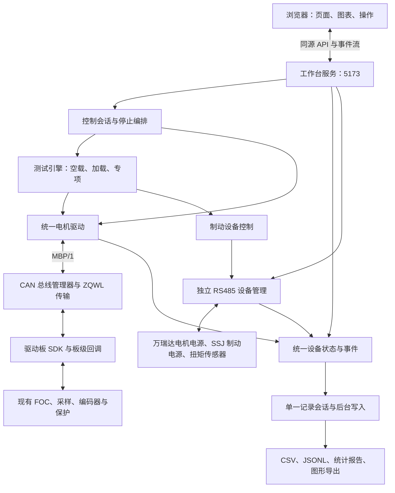

# 统一电机协议、驱动板 SDK 与工作台链路重构方案

方案基线：1.0。日期：2026-10-26。目标线协议：MotorBench Protocol 1.0，简称 MBP/1。目标 SDK：1.0.0。

本文件固化本轮设计、改动范围、迁移顺序和验收条件，供后续按此实施。该文为实施前基线；当前实现及验证进度见 [实施交付](motor-sdk-implementation.md)。本轮代码交付未操作真实设备。协议和 SDK 的正式 1.0 发布以本文规定的实现与验证完成为条件，不将方案版本当作已部署版本。

## 1. 要实现的结果与边界

新驱动板实现 SDK 的板级回调，声明真实能力和限值，即可通过 USB-CAN 接入工作台。页面、加载流程、曲线和记录依赖统一接口，不再识别厂商品牌、工程目录、私有参数编号或具体固件版本。

工作台和 SDK 核心不管理 A/B 固件槽位、镜像选择、升级确认或回退。这些属于驱动工程及独立 CAN-OTA 维护链路；运行任一槽位的应用只要实现兼容 MBP 接口，就按同一方式接入工作台。

- 上位机可独立维护页面、测试策略、数据分析和记录；兼容协议下不要求驱动板跟随升级。
- 驱动板可独立维护 FOC、ADC、编码器、功率级和保护；兼容 SDK 接口下不要求修改上位机。
- SDK 可独立发布修复；板级项目重新编译集成后部署，不表示只替换电脑端文件就能升级 MCU。
- 首次移植仍需实现板级回调。不能修改固件的第三方驱动板，需要专门适配器，不能仅凭 USB-CAN 直接通用。
- 最大输出、弱磁、温度、同拍采样和波形都是设备实际能力；更新通信 SDK 不会凭空产生这些能力。
- 本轮设计覆盖当前测试链路的解耦与冗余清理，不借此重写已验证的 FOC 算法、调整控制参数或增加停机阈值。

第一版实机验收范围固定为：当前 ZQWL USB-CAN、经典 CAN、500 kbit/s、一个驱动轴、Windows 与 Ubuntu 主机。报文预留节点地址，但多驱动并行、CAN FD、其他 USB-CAN、通用 OTA 不作为首版已完成能力。新板只实现基本控制时，先通过对应测试能力验收，再逐项扩展。

## 2. 当前工程已经存在的耦合

以下结论来自当前源码只读核对，不代表这些文件今天被改动。

| 当前位置 | 现有职责或耦合 | 重构目标 |
|---|---|---|
| `scripts/web_server.py` | 5173 提供静态页面，再把 API 转发至 8766 | 保留静态资源、局域网认证和来源校验；去掉本机 HTTP 转发 |
| `hardware_bridge.py` | 8766 同时包含 HTTP、设备实例、供电驱动和全局装配 | 设备驱动、应用控制与 HTTP 路由分开；由一个服务装配 |
| `motor_current.py` | 再经 8892 HTTP 访问西格服务，检查 `project_root`，使用 ID7、MODE5/7 和固件版本分支 | 统一电机控制器只操作能力、状态、运行配置和命令结果 |
| `vendor/xige_foc/scripts/foc_web.py` | 约 7000 行，包含工程网页、CAN 会话、控制、诊断和 OTA | 提取必要 CAN 传输与设备能力，最终从工作台运行包删除整套工程网页服务 |
| `safety_control.py`、`motor_current.py`、`coupled_current.py`、`brake_current.py` | 各有 lease、取消、启动/停止、轮询与任务收尾 | 一个会话控制器决定谁可发控制，一处停机编排，设备各自执行底层动作 |
| `web/src/controlClient.js` | 全局替换 `window.fetch`，第二套请求代际与错误后紧急停止逻辑 | 显式 API 客户端和一个控制会话；保留必要停止语义 |
| `web/src/App.jsx` 及各控制面板 | 多处轮询并重复维护设备状态、派生状态和忙碌状态 | 一个共享设备状态来源；组件只订阅需要显示的数据 |
| `workbench_recordings.py`、`background_recording.py`、`loaded_timeline.py`、`run_recorder.py` | 会话生命周期与采集存在重叠，但部分原始数据各有用途 | 一个记录会话和事件来源；保留必要原始数据，按需生成不同导出 |
| `workbench_config.py`、启动脚本、打包脚本 | 查找独立西格工程、相邻目录、桌面路径、8892 服务身份 | 显式设备配置、版本化接入模块和一个受管理服务 |
| `web/src/CoupledCurrentPanel.jsx` | 按 `0x0A3C` 判断最大输出 | 按 `MAX_AVAILABLE_IQ` 能力与实际就绪状态判断 |
| `web/src/EncoderCompareView.jsx` 与电机档案 | 页面中有 9.78，电机档案中有 9.67 | 一个经过确认的传动比配置，记录其来源；不自动选一个覆盖另一个 |
| `docs/can-interface-contract.md` | 仍是 10 月 8 日 CANable/Web Serial 规划 | 重构发布时更新当前接口文档，旧规划明确归档 |

当前链路：浏览器 → 5173 网页/代理 → 8766 硬件桥 → 8892 西格 HTTP 服务 → USB-CAN → 驱动板。RS485 设备由硬件桥访问。

## 3. 最终架构：一个应用服务、一个控制入口、一个采集来源



最终保留一个 Python 应用进程，统一服务本机 5173；设备 IO、控制调度、记录写入使用独立且有界的工作任务。8766/8892 不再是工作台内部通信依赖。单进程不等于在 HTTP 线程内执行串口等待、CAN 批量读取或文件写入。

职责固定如下：

1. `CanBusManager` 独占一个 CAN 适配器，负责收发、错误统计和优先级。HTTP、图表、记录器不直接打开适配器。
2. `MotorDevice` 编解码协议、维护设备身份/会话和反馈缓存，不决定加载台阶。
3. `ControlCoordinator` 管理浏览器控制权、命令代际、启动与停止编排；测试引擎只提交控制意图。
4. `TestEngine` 保留两阶段加载、步进、专项测量等策略；不直接拼 CAN 帧，不另起浏览器租约。
5. `DeviceStore/EventHub` 保存接收得到的状态和事件；读取缓存不会刷新设备数据的采样时间。
6. `RecordManager` 持有唯一记录会话；采集、显示、导出共享真实来源，各自处理频率不混同。

## 4. 首版协议采用的方式

采用专用、版本化的 MBP/1 应用协议：快速停止/状态/采样用固定 CAN 帧；身份、能力、配置和普通控制事务用 ISO-TP 承载。采用 ISO-TP 的目的，是复用已定义的长消息分片与流控，避免再做一套临时拼包协议；它本身不定义电机命令。[Linux 官方 ISO-TP 文档](https://docs.kernel.org/networking/iso15765-2.html)

控制状态与实际状态分离的设计参考 [CiA 402 官方说明](https://www.can-cia.org/can-knowledge/cia-402-series-canopen-device-profile-for-drives-and-motion-control)；身份、心跳、设定值和实测反馈分消息的思路参考 [ODrive CAN 协议](https://docs.odriverobotics.com/v/latest/manual/can-protocol.html)。MBP/1 不宣称兼容 CANopen 或 ODrive，不能直接混用其报文。

第一版固定：11 位标准帧、经典 CAN、数据帧 DLC=8、小端整数、地址点对点。SDK 原生节点 `n=1..63`，当前板原生接口默认 `n=1`；首版不做自动改节点、广播使能、自动扫速率。节点由板级配置和工作台设备配置明确指定。SDK 对外只承诺一个轴，保留对象中的 `axis_id=0`。

## 5. CAN ID 与固定帧

| CAN ID | 方向 | 内容 | 说明 |
|---|---|---|---|
| `0x080+n` | 主机 → 板 | STOP | 最高软件调度优先级；固定引导契约 |
| `0x100+n` | 主机 → 板 | CONTROL_HEARTBEAT | 当前有效控制会话的 64 位标识 |
| `0x140+n` | 板 → 主机 | DEVICE_HEARTBEAT | 设备 uptime 与 boot 标记 |
| `0x180+n` | 板 → 主机 | STATUS | 实际状态、模式、状态标志、最近处理的 STOP 编号 |
| `0x200+n` | 板 → 主机 | SAMPLE | 带采样序号的实测字段及组结束标记 |
| `0x240+n` | 板 → 主机 | EVENT | 现有故障/状态变化事件，详细上下文走对象消息 |
| `0x400+n` | 主机 → 板 | ISO-TP 应用通道 | 身份、能力、控制、配置、读回及诊断请求 |
| `0x440+n` | 板 → 主机 | ISO-TP 应用通道 | 请求结果、对象返回及对应反向流控 |
| `0x480+n` | 主机 → 板 | ISO-TP 诊断通道 | 可选诊断/冻结数据请求，独立低优先级事务 |
| `0x4C0+n` | 板 → 主机 | ISO-TP 诊断通道 | 可选诊断返回及对应反向流控 |

原生协议不分配 `0x580..0x6FF`，为现有 OTA/参数维护通道保留空间。当前板维护协议继续使用原 OTA 节点 0，其 `0x600/0x580`、参数 `0x610/0x590` 不因原生节点改为 1 而迁移；两个节点概念分别记录。保留 ID 不表示允许两套电机控制同时运行。

固定帧字节定义：

| 帧 | 字节 0..7 |
|---|---|
| STOP | ASCII `STOP` 四字节 + `stop_id:u32` |
| CONTROL_HEARTBEAT | `session_id:u64` |
| DEVICE_HEARTBEAT | `boot_tag:u32` + `uptime_ms:u32` |
| STATUS | `state:u8` + `mode:u8` + `flags:u16` + `last_stop_id:u32` |
| SAMPLE | `sample_seq:u16` + `field_id:u8` + `flags:u8` + `value:u32` |
| EVENT | `event_code:u16` + `severity:u8` + `source:u8` + `device_ms:u32` |

STOP、身份查询的引导规则不可重新解释为其他动作。协议主版本不兼容时，只做识别、诊断和保持上述语义的停止，禁止按未知协议使能。STOP 不要求已成功建立控制会话，重复停止不造成重新使能；软件 STOP 不宣称为硬件 STO。

STATUS 的状态枚举固定为 `0 DISABLED / 1 STARTING / 2 RUNNING / 3 STOPPING / 4 FAULT`。`mode` 固定为 `0 NONE / 1 IQ / 2 TORQUE / 3 VELOCITY / 4 POSITION / 5 MAX_AVAILABLE_IQ`，只声明实际实现的模式。当前板映射 MODE5→IQ、MODE7→MAX_AVAILABLE_IQ，具体编号只存在板级映射中。

STATUS 标志分别表达 `output_on`、`ready`、`fault_active`、`start_inhibited`、`sample_valid`、`maintenance`；保留位发送 0。FAULT 详情不能只给一个笼统“通信失败”，应包含统一分类与厂家原始代码。

上述 STATUS 标志按顺序占 bit0..bit5。SAMPLE flags 的 bit0=valid、bit1=estimated、bit2=quality_warning，其他位保留。EVENT 的 severity 为 `0 info / 1 warning / 2 fault`；warning 不自动升级为停机条件。

## 6. 对象消息、请求与控制会话

ISO-TP 使用 normal addressing，控制通道最大应用 PDU 为 1024 字节，诊断通道为 256 字节，禁止无界分配；首版每节点每逻辑通道同向只允许一个在途应用事务。大块冻结数据由多个有界请求读取。两个通道共享 CAN 所有者与设备会话，不是两套控制服务；诊断不得占用控制通道的事务锁。STOP 始终走独立固定帧，不等待对象事务完成。ISO-TP 流控、分片超时或序号错误只丢弃本次消息，不执行半条命令。

应用头固定 16 字节：`magic[4]='MTBP'`、`major:u8`、`minor:u8`、`opcode:u8`、`flags:u8`、`request_id:u32`、`body_length:u16`、`reserved:u16`。头长度、消息长度和保留位由生成的编解码器校验。多字段对象使用 TLV：`object_id:u16 + type:u8 + length:u16 + value`，整数不按 MCU 原生结构体直接拷贝。

应用 flags 的 bit0=response、bit1=error，其他位保留；错误响应仍用相同 request_id。TLV 类型固定为 `1 u8 / 2 u16 / 3 u32 / 4 u64 / 5 i32 / 6 i64 / 7 bool / 8 UTF-8 / 9 bytes / 10 nested-TLV`；bool 只接受 0/1，字符串不含隐式结尾零，长度始终按字节计。IDENTIFY 属于固定引导契约，其基础身份对象可在尚未完成主版本协商时读取。

所有改变运行状态的普通请求还携带 `boot_id:u64`、`session_id:u64`、`run_generation:u32`、`command_seq:u32`。读请求不隐式建立控制权。

| opcode | 名称 | 接口语义 |
|---|---|---|
| `0x01` | IDENTIFY | 返回身份、协议版本、SDK 版本、厂家固件版本、完整 boot_id |
| `0x02` | READ_OBJECTS | 读取能力、限值、就绪信息或明确的对象集合 |
| `0x03` | CLAIM_CONTROL | 在输出关闭且设备允许时申请一个新会话 |
| `0x04` | RELEASE_CONTROL | 释放会话；运行中先走停止，不把释放当作保持运行 |
| `0x05` | PREPARE_RUN | 校验并读回本次运行配置，返回 `prepared_id`；不使能 |
| `0x06` | START | 携带 `prepared_id` 和代际，调用本地使能接口 |
| `0x07` | SET_TARGET | 对当前会话和代际更新目标，不切换隐藏的控制模式 |
| `0x08` | CLEAR_FAULT | 可选；设备声明支持且由显式操作触发 |
| `0x09` | SET_STREAMS | 申请反馈组及周期，返回实际采用的周期 |
| `0x0A` | READ_DIAGNOSTIC | 可选只读扩展，不占用停止优先级 |
| `0x0B` | READ_TRANSFER | 可选冻结数据读取，按块校验完整性 |
| `0x0C` | READ_STATE | 返回完整状态、当前会话代际及最近控制结果 |

响应沿用相同 opcode 和 request_id，通过响应标志区分，结果统一为 `OK / PENDING / UNSUPPORTED / INVALID_ARGUMENT / OUT_OF_RANGE / NOT_READY / BUSY / STALE_SESSION / STALE_GENERATION / DEVICE_FAULT / TIMEOUT`。ACK 表示命令被接收或应用的阶段，不表示实际电流已达到目标。

响应体以 `result:u16 + stage:u8 + reserved:u8` 开始，上述结果按表中顺序编号 0..10；阶段为 `0 accepted / 1 applied / 2 confirmed`，随后返回本 opcode 的结果 TLV。异步动作先返回 PENDING，实际完成由状态/事件及 READ_STATE 确认，不阻塞一个 HTTP 请求等待整个测试完成。`READ_DIAGNOSTIC/READ_TRANSFER` 只使用诊断通道，其他 opcode 使用控制通道。

具体规则：

- boot_id 代表一次设备启动实例；重启、重连或发现 boot_tag/uptime 异常后，主机重新 IDENTIFY，旧缓存和旧准备结果失效。
- session_id 是不重复复用的当前会话标识，不是密码，不提供对恶意 CAN 节点的认证。
- STOP 使当前运行代际失效，取消未执行的 START/SET_TARGET；控制队列与 USB 待发送队列清理旧代际。
- 相同 request_id 和相同内容在有限去重窗口内返回原结果；同一 ID 改变内容时拒绝。去重窗口和有效范围属于协议实现参数并进入测试。
- 有限窗口之外，改变状态的请求不得因为“没收到 ACK”而自动重发。结果未知时先读状态、必要时 STOP，再重新准备。
- 接收过期或乱序的 command_seq 不得复活旧运行；运行代际与序号共同判定，不只比较一个会回绕的小计数器。
- 请求结果写明 `accepted/applied/confirmed` 阶段；START 仍需新鲜 RUNNING/output_on 反馈，停止仍需 `last_stop_id` 与输出关闭反馈。
- 首版协议不开放任意地址的参数写入、SAVE、Flash 擦写、校准启动或固件升级；这些属于独立维护接口。

## 7. 数据、单位和时间基准

| 数据 | 线协议表示 | 对外含义 |
|---|---|---|
| `iq_target / iq_reference / iq_actual / id_actual` | `i32`，1 mA | 分别是操作者目标、驱动分配/斜坡后参考、实测 q/d 电流 |
| `rotor_speed` | `i32`，0.001 rpm | 电机转子机械转速，保留正负方向 |
| `rotor_position` | `i64`，0.000001 转 | 电机转子多圈机械位置，不能用单圈角度冒充 |
| `bus_voltage / bus_current` | `u32 mV / i32 mA` | 实测母线值；估算值使用独立字段 |
| `dq_voltage_limit` | `u32 mV` | 控制器可用电压矢量边界，与母线电压分开 |
| `motor_temperature / board_temperature` | `i32`，0.001 °C | 温度来源与有效性明确，缺少时不填 0 |
| 转矩 | `i32`，1 mN·m | 标明实测或估算、轴侧和标定来源；不替代外置传感器实测 |
| 时间 | `u64 us` | 本次启动后的设备采样时间；另存主机接收单调时钟与 UTC |

SDK 的 dq 电流定义固定为幅值不变 Clarke/Park 约定下的相电流峰值等效安培；板级端口必须明确转换来源。该换算是坐标及量纲转换，不等于重新标定传感器。只提供 RMS 电流或估算电流的板，必须声明其定义和来源；不能确定转换时，不声明兼容的 IQ 测试能力。

SAMPLE 字段首版编号：`0 time_us_low / 1 time_us_high / 2 iq_actual / 3 iq_reference / 4 id_actual / 5 rotor_speed / 6 position_low / 7 position_high / 8 bus_voltage / 9 bus_current / 10 motor_temperature / 11 board_temperature / 12 iq_target / 13 dq_voltage_limit / 14 estimated_bus_current / 15 reserved / 254 group_end`。`group_end.value` 是该组 0..31 字段的存在位图。

- SAMPLE flags 区分有效、估算、质量告警；未声明的字段不发送，声明但本次无效时标为无效。无效载荷不参与显示和计算。
- 一组必须具有相同 sample_seq；时间和 64 位位置的两个半字只在同组齐全时合成。组结束前的残片不能拼进下一组。
- 按协商组配方收齐必需字段并收到 group_end 才发布组；缺片、重复、过期分别计数。非必需字段不阻塞独立的有效数据组。
- 实时组建议 20 ms；温度及慢量建议 200 ms；这些是初始协商值，不作为新增电机停机条件。实际频率与允许数据年龄独立记录。
- 不同传感器源的数据不得因为落在同一个发送组，就声明为物理同时采样。每组记录来源/一致性说明，慢量保留本源时间。
- 主机超时采用接收单调时钟，UTC 用于记录展示；设备时间和 sample_seq 回绕按启动实例处理。重复读取缓存不产生新样本。
- JSON 的完整 i64 位置/计时采用十进制字符串传递，避免浏览器整数精度损失；显示用换算值，原始整数持续保留。
- 当前 `foc_mode_feedback_stat()` 已有 64 位累计计数源，但旧返回报文把毫度值夹紧到 INT32 范围。SDK 端口必须直接读取一致的原始累计计数，做防溢出的 64 位单位转换，不能强转已经夹紧的旧 A7 报文。
- 传动比、输出轴方向及传感器轴侧属于台架档案。9.67/9.78 的现有差异先核实来源，记录最终值后才统一，不在重构时猜测覆盖。

首版单轴稳态 CAN 预算目标为不超过约 40% 的持续占用，为命令和重传预留余量。它是设计/验收预算，不能新增为自动停机条件；超预算优先压低可选诊断流，不能默默丢失控制命令或伪造反馈。

## 8. 能力、限值与测试开放条件

对象空间固化为：`0x0000..0x00FF` 身份/版本、`0x0100..0x01FF` 能力、`0x0200..0x02FF` 限值/量纲、`0x0300..0x03FF` 就绪/故障、`0x1000..0x10FF` 本次运行配置、`0x2000..0x20FF` 反馈组配置、`0x3000..0x30FF` 最大输出、`0x4000..0x40FF` 扩展诊断、`0x5000..0x50FF` 冻结数据、`0x8000..0xBFFF` 厂家只读扩展，其余保留。具体对象表、类型和取值以生成源文件统一维护，不让网页另写编号表。

核心对象编号与类型在本方案中明确如下；所有对象均以规定量纲表示，省略对象与返回有效的零值不同：

| object_id | 名称与类型 | 规则 |
|---|---|---|
| `0x0001` | device_uid，bytes | 16 字节稳定设备标识；不是串口名称 |
| `0x0002` | hardware_identity，UTF-8 | 厂家、板型与硬件修订可追溯 |
| `0x0003` | firmware_version，UTF-8 | 厂家自由版本，不用于推算通用能力 |
| `0x0004` | sdk_version，UTF-8 | SDK 语义版本 |
| `0x0005` | boot_id，u64 | 完整本次启动身份 |
| `0x0100` | control_modes，u32 | bitN 表示支持第 N 个模式 |
| `0x0101` | feedback_fields，u64 | bitN 表示支持第 N 个 SAMPLE 字段；附带独立质量描述 |
| `0x0102` | optional_features，u64 | 最大输出、弱磁、一致采样、窗口、轨迹等特性；由唯一 schema 固定 bit 分配 |
| `0x0200` | dq_current_convention，u8 | MBP/1 IQ 接入值固定为 1，代表本文规定的电流定义 |
| `0x0201` / `0x0202` | iq_min / iq_max，i32 | 可请求的 q 电流范围，mA；不是物理极限认证 |
| `0x0203` | phase_protection_current，u32 | 设备当前相电流保护值，mA，未知时不返回 |
| `0x0204` | phase_run_limit_max，u32 | 允许本次请求的相电流运行上限，mA |
| `0x0205` | allowed_negative_id_min，i32 | 有依据的负 Id 下限，mA；无依据时为 0 且不声明弱磁 |
| `0x0206` | dq_voltage_limit，u32 | 当前可用 dq 电压边界，mV |
| `0x0207` | rotor_speed_abs_max，u32 | 设备声明的转速范围，0.001 rpm；未知时不返回 |
| `0x0208` | motor_temperature_trip，i32 | 设备现有温度边界，0.001 °C；与启动抑制标志分开 |
| `0x0209` | device_watchdog_ms，u32 | 设备实际采用的通信监督时间，只读 |
| `0x0300` | readiness_flags，u32 | 就绪、校准状态、数据质量和抑制分类 |
| `0x0301` | fault_category，u16 | 通信、过流、过温、采样、位置反馈等统一分类 |
| `0x0302` | vendor_fault_code，u32 | 厂家原始代码，不能被统一分类覆盖丢失 |
| `0x0303` | readiness_detail，UTF-8 | 人可读的实际未就绪原因 |
| `0x1000` | run_mode，u8 | 本次选择的模式 |
| `0x1001` | direction，i32 | 最大输出使用 +1/-1；当前默认 +1 |
| `0x1002` | iq_target，i32 | 固定电流模式目标，mA |
| `0x1003` | phase_run_limit，u32 | 本次相电流上限，mA；0 为既有边界内自动分配 |
| `0x1004` | bus_current_budget，u32 | 本次供电能力，mA；不冒充相电流能力 |
| `0x1005` | bus_voltage_basis，u32 | 本次分配使用的供电电压依据，mV；实测另存 |
| `0x1006` | negative_id_min，i32 | 本次允许负 Id，mA；默认 0 |
| `0x1007` | speed_soft_limit，u32 | 可选本次软上限，0.001 rpm；默认 0 关闭 |
| `0x2000` | stream_groups，nested-TLV | 已定义的字段组、源一致性、请求/采用周期和字段有效性 |
| `0x3000` | maximum_state，u8 | `0 NOT_STARTED / 1 WARMING_UP / 2 VALID / 3 UNAVAILABLE` |
| `0x3001` | available_iq，i32 | 当前分配允许的 q 电流，mA |
| `0x3002` | active_limits，u32 | 当前限制来源，不是故障字 |
| `0x3003` | maximum_window，nested-TLV | schema、窗口序号/时长、跟踪、饱和、质量、源时间 |
| `0x4000` | diagnostic_descriptor，nested-TLV | 可选诊断的类型、版本与来源 |
| `0x5000` | frozen_transfer_descriptor，nested-TLV | 数据集标识、格式版本、点数、长度及完整性校验 |

`optional_features` 的 bit0..bit4 分别固定为 MAX_AVAILABLE_IQ、FIELD_WEAKENING、COHERENT_SAMPLE、MAX_WINDOW、FROZEN_TRACE，其他位保留。控制模式与反馈字段分别由前两个能力对象表达，不重复用另一个布尔值推导。首版 `feedback_fields` 的高 32 位保留为 0，与 group_end 的存在位图范围一致。

`readiness_flags` 的 bit0..bit5 分别为 ready、calibration_required、calibration_valid、temperature_start_inhibited、fault_latched、control_feedback_valid。设备声明不需要电角校准时，不把 calibration_valid=0 直接判为故障；当前西格端口明确声明需要校准。`fault_category` 固定为 `0 none / 1 communication / 2 current / 3 temperature / 4 sampling / 5 motion_feedback / 6 configuration / 7 computation / 255 vendor_other`，详细原因仍保留厂家代码。`active_limits` 的 bit0..bit4 分别为 current、voltage、source_estimate、adc_range、speed_soft_limit。

PREPARE_RUN 返回同一对象集合中的实际应用值，以及有效的 prepared_id；START 必须引用此结果。不同模式只接受其明确相关对象，无关或未知的必需配置被拒绝。`SET_TARGET iq=0` 表示零电流目标，不隐式 START 或切换模式；关闭输出使用 STOP。

能力至少分成控制能力、反馈能力和诊断能力：`IQ_CONTROL / TORQUE_CONTROL / VELOCITY_CONTROL / POSITION_CONTROL / MAX_AVAILABLE_IQ / FIELD_WEAKENING / SPEED_FEEDBACK / MULTITURN_POSITION / IQ_FEEDBACK / ID_FEEDBACK / TEMPERATURE / POWER_FEEDBACK / COHERENT_SAMPLE / MAX_WINDOW / FROZEN_TRACE`。

| 测试 | 必需能力与条件 | 不满足时的行为 |
|---|---|---|
| 只读接入 | 身份、状态、故障、反馈有效性 | 保持只读并显示实际缺失项 |
| 电流目标测试 | IQ_CONTROL、IQ_FEEDBACK 及明确限值 | 不显示为电流测试就绪 |
| 转矩目标测试 | TORQUE_CONTROL 与对应反馈，或已明确的独立测量方案 | 不暗中用未经确认的 Kt 换算 |
| 当前两阶段力矩测试 | 电机控制、转速、当前联合停转需要的多圈位置及质量反馈；外部扭矩传感器和制动电源 | 禁止该项启动，其他已满足的测试仍可用 |
| 最大输出测试 | MAX_AVAILABLE_IQ、IQ/ID 反馈、动态限制反馈及上述加载条件 | 不降级成固定 10 A 并称作最大输出 |
| 弱磁测试 | FIELD_WEAKENING、明确允许负 Id 范围 | 保持 Id=0；不能用一个通用 -30 A 下限代替电机资料 |
| 温度图与温度相关测试 | 有效温度与来源 | 温度留空，按测试需求判断该项可否进行 |

最低 SDK 接入需实现身份、状态、停止、至少一种明确控制模式、该模式的目标与实测反馈、转速反馈。不同测试在此基础上要求额外能力。当前西格端口仍保留现有编码器、电角校准、NTC、过流等全部就绪和运行检查；把检查归位不等于移除检查。

限值对象区分厂家额定值、设备当前保护值、允许运行配置范围、本次请求值和实际动态可用值。未知值是 unknown，不推测为 10 A/30 A；通用层不能根据厂家固件版本计算上限。

## 9. 最大输出接口的固定语义

请求模式为 `MAX_AVAILABLE_IQ`，方向显式指定，本轮默认沿用当前正方向；传入母线能力、可选相电流运行上限、允许负 Id 下限和可选转速软上限。`phase_limit=0` 表示在设备既有边界内自动分配，不表示关闭设备保护；`negative_id_min=0`、`speed_soft_limit=0` 分别沿用当前关闭弱磁/关闭可选软限速语义。

驱动板本地持续计算可用电流参考，SDK 只传递配置、请求与实际结果。通用上位机不通过 HTTP/CAN 反复试探加流来模拟 FOC 内部最大输出。

返回至少包括：实际模式、已应用配置、Iq/Id 参考及实测、当前运行电流边界、母线与 dq 电压、限制来源、统计窗口编号/持续时间/质量及原始设备故障。限制枚举包含电流、电压、供电估算、采样范围、可选转速限制和厂家扩展。

窗口与轨迹属于可选、版本化扩展。未启动时返回 `NOT_STARTED`，不足一个窗口时返回 `WARMING_UP`，而不是将全零缓冲区当成正常窗口或“协议不兼容”。当前 200 ms 统计窗口、2 kHz/256 点冻结轨迹先保持不变，明确漏读、覆盖与导出完整性。

电压饱和、正常跟踪波动、磁诊断及采样质量标记继续用于记录和解释结果，不额外增加停机线。“达到可用配置边界”和“证实物理极限”分开标注，测量标定要求继续保留。

## 10. SDK 的接口与职责

SDK 提供纯 C 接口、固定宽度类型、静态内存配置，不依赖具体 STM32/N32/RTOS，也不包含板卡 HAL、FOC 控制器和厂家 Flash 参数布局。首版不在控制 ISR 内做对象解析、浮点 JSON、文件操作或动态内存分配。

SDK 公共入口的目标接口如下，具体结构体字段由协议源生成。这些是接口设计，不是本轮新增源代码：

| 接口 | 调用位置 | 责任 |
|---|---|---|
| `mb_sdk_init(ctx, config, port, memory)` | 系统初始化 | 校验 SDK API 版本、节点、能力与静态缓冲配置 |
| `mb_sdk_on_can_rx_isr(ctx, frame)` | CAN 接收入口 | 有界入队；将有效 STOP 放入独立优先处理槽，不执行普通控制解析 |
| `mb_sdk_poll(ctx, now_us)` | 通信任务/主循环 | 非阻塞推进协议、处理优先停止、对象请求、流控和状态发布 |
| `mb_sdk_publish_snapshot(ctx, snapshot)` | 采样发布边界 | 接收已完成、带源时间与有效性的快照；可使用有界双缓冲 |
| `mb_sdk_report_event(ctx, event)` | 故障/状态变化路径 | 发布已有事件与上下文，不决定新增保护 |
| `mb_sdk_get_status(ctx)` | 设备任务/诊断 | 返回 SDK 会话、队列与协议计数，不能触发控制动作 |

板级端口需提供的回调：

| 回调 | 具体含义 |
|---|---|
| `can_try_send(frame, priority)` | 非阻塞提交 CAN；返回提交结果，不能把提交当作驱动板动作确认 |
| `clock_us()`、`boot_identity()` | 单调计时与本次启动身份；boot_tag 只作为短标记，不能代替完整身份 |
| `read_descriptor()` | 身份、已实现能力、量纲、限值范围和数据来源 |
| `read_state()`、`read_snapshot()` | 已采集状态和一致快照；不在这里临时轮询 ADC/SPI 来凑一帧 |
| `prepare_run(config, applied)` | 检查并应用必要的易失运行配置，返回真实读回；不使能、不保存 Flash |
| `request_start(prepared_id)` | 启动已有控制模式，结果与实际状态分开反馈 |
| `set_target(target)` | 设置已有控制环目标，量纲转换在此明确完成 |
| `request_disable(reason)` | 请求已有停机路径；必须声明执行上下文和可验证的最大处理延迟 |
| `clear_fault()` | 可选；按原有设备复归规则执行 |
| `read_diagnostic()`、`read_frozen_chunk()` | 可选只读诊断，限时/分块，能被控制和停止打断 |

STOP 在 SDK 中有独立标志/槽，不会排在诊断分片后面。`request_disable` 若不允许 ISR 调用，就在下一个合适的高优先级设备任务执行；实现时实测其延迟，不把不同 MCU 的停止时序虚构成一致。

能力声明由端口实现、对象支持与实际数据来源共同校验。回调缺失就不声明对应能力。端口可处于 not_ready，不能因为 SDK 已初始化就声称电机可运行。

SDK 初始资源预算目标：核心静态 RAM 不超过 8 KiB、Flash 不超过 24 KiB；预算须包含传输和队列缓冲，实际以编译 map/size 验证。超预算时先检查缓冲与模块配置，不能挤占现有实时控制栈或静默删掉协议检查。

## 11. 当前 N32G455/西格板如何接 SDK

新增板级映射文件，把 SDK 的 IQ、MAX_AVAILABLE_IQ、停止、状态、采样和诊断映射到当前 `foc_mode`、`foc_adc`、`foc_encoder` 与最大输出实现。SDK 不复制第二套 FOC，不再让上位机读 ID0/1/2 来决定所有厂家的电角校准。

- 当前 MODE5/7、10 kHz 控制环、R/L、PI、9 V、PWM 范围、100 A/s 斜坡及已有保护保持原行为。
- 当前运行期 ID7 设置与读回的必要行为移到 `prepare_run` 的板级实现，以命名的运行配置表达；不扩大范围、不保存 Flash，不在通用上位机里按版本写 ID7。
- 当前过温启动抑制、过温跳闸、传感器失效和故障锁存分别上报；归位后不得丢掉原有检查，也不能把普通质量标记升级成保护。
- `ota_can` 目前按 OTA/参数 ID 分流且具有接收过滤约定。增加统一 CAN 分发层或扩展其通用收发接口，确保 SDK 帧进入正确接收路径；只新增 SDK 文件而不修改分发不能完成接入。
- 原 OTA/参数维护读操作和 STOP 可按明确维护模式保留。生产配置禁止旧 `MOTOR_CTRL/CTRL_SET` 等入口绕过 SDK 会话直接使能；旧报文不能维持新会话心跳。
- Bootloader 分区、现有校准/Flash 参数页不因协议重构被擦除。SDK 版本不替代 App 固件版本，实际发布按既有工具分配新的 App 版本。

## 12. 上位机内部接口与 HTTP 接口

内部电机接口统一为：`connect / identify / capabilities / read_state / latest_snapshot / prepare_run / start / set_target / stop / subscribe_events / read_diagnostic`。所有返回对象包含设备 ID、启动实例、数据来源和状态；不包含 `XIGE_ROOT` 作为兼容条件。

第一版 HTTP API 使用显式 `/api/v1/` 命名：

| 接口 | 用途 |
|---|---|
| `GET /api/v1/state` | 获取设备、控制会话、测试和记录的一致初始状态 |
| `GET /api/v1/events` | 单一 SSE 事件流，带递增 event_id，供页面订阅 |
| `POST /api/v1/connections/start` | 只读恢复/检查配置，不开启任何输出 |
| `POST /api/v1/control/claim`、`/heartbeat`、`/release` | 一处浏览器控制权管理 |
| `POST /api/v1/motor/prepare`、`/start`、`/target`、`/stop` | 独立电机操作，经同一个协调器执行 |
| `POST /api/v1/tests/start`、`/load`、`/stop` | 测试策略请求；仍保留两次独立启动动作 |
| `POST /api/v1/supplies/{id}/output` | 电源动作，继续读回真实输出状态 |
| `POST /api/v1/recordings/start`、`/stop` | 一个记录会话；导出只读取已落盘数据 |

读取状态不发送电机控制命令，不刷新控制租约，不为页面临时排队读取九个诊断 bank。页面通过显式 `apiClient` 发请求，共享 `deviceStore` 订阅事件；移除全局 fetch 劫持和多组件重复轮询。断线后先取完整状态，再恢复事件游标；事件重放不能重放控制命令。

保留现有本机来源检查、局域网认证、停止不等待普通命令锁等要求，合并实现而不是删除。浏览器身份、控制 epoch 与认证令牌各有不同职责，统一客户端处理，但不把认证与控制权混成一个布尔值。

## 13. 控制生命周期与停止职责

固定正常流程：发现/连接 → 识别 → 能力匹配 → 设备就绪 → PREPARE 并读回 → START → 新鲜运行确认 → 等待操作者加载 → 分级加载 → 冻结终点 → 统一停止确认 → 记录收尾。

只保留两种确有不同故障边界的监督：浏览器到主机的控制租约，以及主机到驱动板的通信看门狗。取消各测试引擎各自持有浏览器 lease、互相代喂 lease 和 GET 查询代喂心跳。租约、停止和状态确认由 `ControlCoordinator` 负责，MCU 既有看门狗留在板上。

当前实现存在浏览器 750 ms 心跳、主机多处 2.5/3 s 判断、驱动板 1000 ms 监督及约 250 ms 心跳链路。实施第一步先记录每条实际生效路径；迁移时保持现有场景的有效超时语义，不借“统一”放宽保护或无依据缩短超时。具体参数属于版本化测试策略/设备档案，不能散落在多个循环中。

| 操作/原因 | 协调动作与完成条件 |
|---|---|
| 连接或重连 | 只读识别，不 START、不恢复旧目标、不自动开启电源 |
| 测试正常停止/手动停止测试 | 使电机输出关闭、关闭制动输出；保留关闭前的终点；沿用当前对电机供电的处理策略 |
| 关闭电机电源 | 先取消后续启动/加载，走电机停止和电源 OFF；分别记录确认依据 |
| 关闭制动输出且当前正在联动测试 | 进入联动停止编排，不释放负载后让旧测试继续加流 |
| CAN 停止未确认 | 沿用现有电机供电隔离和放电确认兜底；不能伪造 CAN 已确认 IDLE |
| 已有设备保护/通信故障/控制租约失效 | 继续触发既有停止策略，记录唯一主原因与后续结果 |
| 电压饱和、正常跟踪波动、新增诊断质量标记 | 记录与解释，不添加新停止条件 |

停止状态区分 `requested / command_sent / device_disabled / power_isolated / unconfirmed`。驱动板 IDLE、物理供电隔离和机械停转属于不同证据，不压成同一个成功标志。清理停机流程时保留现有验证和兜底能力。

当前顶部“关闭制动输出”实际进入统一停止路径的语义，需要在迁移时对照动作矩阵校正名称与行为；以实际作用范围显示按钮名称，避免将联动停止描述为只关一个设备。

## 14. 采集、记录与图表链路

CAN/RS485 接收 → 有效数据事件 → 统一设备状态和记录写入 → 页面显示/离线分析。记录器不再为了自身记录重新查询 CAN；页面采样点、完整原始事件和导出曲线不互相冒充。

- `RecordManager` 负责创建、关联、停止和最终收尾。自动测试可创建会话；已存在的手动记录只关联，仍由原操作方结束。
- 原始事件至少记录设备 UID、boot_id、协议/SDK/固件版本、主机单调时间、UTC、设备采样时间、sample_seq、run_id、命令关联 ID、有效性及来源。
- 电机快照、传感器原始帧、双电源读数、命令/应答、故障和诊断都保留；合并会话管理不代表删除独有数据。
- `timeline.csv`、完整 JSONL 和报告由同一事件来源生成；原完整记录、冻结终点和记录完整性要求继续保留。
- 多种用途的输出文件可继续存在，但不再分别启动采集线程和分别管理“开始/结束”。
- 写入线程与控制队列分离；队列满、磁盘错误或漏读明确入报告，不能阻塞停止命令，也不新增电机停机条件。
- 保留必要的旧记录只读导入器。旧 CSV/JSONL 不改写，缺失的新字段标 unknown；删除协议过渡分支不等于删除历史数据兼容。

## 15. SDK、协议与上位机版本兼容

分别发布四个版本：`wire_protocol`、`sdk_api`、`host_api`、`record_schema`。厂家 firmware_version 只用于展示、追溯与厂家端口内部诊断，不作为通用功能开关。

| 情况 | 固定兼容规则 |
|---|---|
| 协议主版本相同、次版本不同 | 使用双方支持的能力/对象交集；新增可选字段保持可忽略 |
| 协议主版本不同 | 允许身份检查与固定引导 STOP；禁止运行控制，不猜报文含义 |
| 旧 SDK 对接新上位机 | 原有能力继续工作；新增测试显示缺少能力，不要求为页面变化升级 MCU |
| 新 SDK 对接旧上位机 | 保持已发布的基本行为；新能力不被旧上位机自动启用 |
| 同一个功能需要新语义 | 分配新对象或新主版本，不复用旧字段改变单位/含义 |
| 未知普通可选对象 | 返回 UNSUPPORTED 或忽略不请求的字段；其他已协商能力继续可用 |
| 未知且被本次测试声明为必需的语义 | 该测试不能启动，不将其静默降级为其他模式 |
| SDK C API 变化 | 按语义版本管理；主版本不兼容需移植回调，结构体携带 size/api_version |
| 厂家固件更新 | 协议与能力未变时继续接入；设备重启后重建启动实例和会话 |

SDK 以源码静态集成，承诺的是指定 API 的源码兼容，不承诺跨 MCU、编译器的二进制 ABI。1.x 不改变既有对象含义、单位、STOP 行为、核心状态转换或回调语义。

发布的 schema、生成头文件、Python 编解码、DBC 与黄金向量绑定同一个协议校验值。SDK 补丁不得悄悄改变已经冻结的线协议；上位机不自动刷 SDK 或固件。

## 16. 当前工程具体改动清单

以下均为后续待实施项，本轮没有执行。

| 当前文件/模块 | 具体处理 | 需要保留的行为 |
|---|---|---|
| `motor_current.py` | 拆出电机策略与统一 MotorDevice；删除 8892 HTTP 调用、工程目录身份检查、私有版本/ID7 分支 | 目标与实际分离、运行期配置读回、启动/停止确认、当前有效保护 |
| `coupled_current.py` | 将加载算法作为 TestEngine 策略；删除独立浏览器 lease 和自建多套停止线程；能力从设备获取 | 两次独立启动、按实测力矩保持、联合停转、终点冻结、现有限界 |
| `safety_control.py` | 归并为单一 ControlCoordinator 的会话、代际和停止模块 | 停止优先、旧命令失效、控制权、供电隔离与真实确认 |
| `brake_current.py` | 保留制动步进/目标策略，设备 IO 归设备管理，去掉重复会话监督 | SSJ 协议、恒流设置读回、当前电流边界 |
| `automatic_tests.py` | 使用同一电机接口和测试协调器，不绕过会话直接操作厂家 API | 原测试配方、记录、用户已确认的边界 |
| `hardware_bridge.py` | 拆出独立设备类与应用装配；HTTP 迁至同源服务，不再作为第二跳服务 | RU 电机供电、SSJ 制动和独立传感器通道与协议 |
| `device_connections.py` | 统一设备注册与只读连接任务；用 USB 身份和设备 UID 关联；进度进入事件流 | 不猜接线归属、不自动开输出、真实应答确认 |
| `power_limits.py` | 留在设备策略层，改为单一命名配置来源 | 24 V/20 A 预设校验、制动现有限幅、设备 OVP/OCP 原值 |
| `workbench_recordings.py` / `background_recording.py` / `loaded_timeline.py` | 合并生命周期和采集来源，保留原始数据与导出投影所需逻辑 | 完整数据、手动记录归属、源时间、异常可追溯 |
| `vendor/xige_foc/scripts/foc_web.py` | 迁移必要 CAN 编解码/传输后，从工作台运行包删除 | 不能把删除网页服务变成丢失协议应答、停止和诊断能力 |
| `vendor/xige_foc/scripts/zqwl.py` | 提取为单独 CAN 传输插件，固定来源与版本 | 当前硬件收发、USB 身份、Windows/Ubuntu 支持 |
| `vendor/xige_foc/scripts/max_output.py` | 诊断模型保留，改用统一扩展对象；删除版本与 bank 编号散落依赖 | 限制来源、质量窗口、冻结数据完整性 |
| `vendor/xige_foc/scripts/run_recorder.py` | 独有字段并入 RecordManager 后移出工作台运行包 | 不丢实际采样、诊断和导出完整性数据 |
| `workbench_config.py` | 删除桌面/相邻西格工程查找；使用显式设备、协议、传输配置 | USB/节点/波特率和台架配置可移植、旧配置有一次迁移 |
| `scripts/workbench.py` / `scripts/launch.mjs` | 只管理一个应用服务和身份；清除 3 端口/外部工程复用路径 | 一键启动关闭、日志、进程归属、已有数据和口令保留 |
| `scripts/web_server.py` | 静态服务与认证逻辑并入新服务，删除 loopback HTTP 代理实现 | 本机默认监听、可选局域网访问、认证与来源约束 |
| `scripts/build_windows_package.py` | 打包统一服务、协议运行库、已验证传输；删除西格工程模块清单依赖 | 固定依赖和校验、重复安装保留记录和本机配置 |
| `web/src/controlClient.js` | 改为显式 apiClient/sessionClient；删除全局 fetch 劫持和第二套 CAN HTTP 会话处理 | 所有者心跳、停止确认、旧请求失效、旁观页面关闭不停止别人的测试 |
| `web/src/App.jsx` | 抽出共享设备状态与控制会话订阅，减少重复派生/轮询 | 最近完成的一键连接合并与万瑞达固定电机供电界面 |
| 各电机/制动/联动面板 | 订阅统一 store，按能力显示测试，不再各自拉取全套状态 | 操作入口、独立第二步加载和实际反馈展示 |
| `web/src/model.js` / `EncoderCompareView.jsx` / 图表与 CSV | 统一数据定义、轴侧、传动比和来源；不重复按厂家字段解释 | 原始符号、实测终点、历史数据、明确的计算量 |
| 当前固件 `ota/ota_can.*` / `ota/ota_params.*` | 增加分发/端口接入，收敛生产控制入口，保留维护兼容边界 | CAN-OTA、分区、已保存校准与原有保护 |
| 当前固件 `foc/foc_mode.*` / 采样与诊断接口 | 增加 SDK 板级回调映射及一致快照发布 | 控制环实现、参数、时序和原始采样责任归属 |
| 文档与测试 | 更新当前接口约定，增加协议/SDK/统一链路验收，归档过时接入规划 | 历史事实明确，不将旧测试通过当作新实现验收 |

建议新增结构以职责为边界，不为每个小函数创建一层：

```text
protocol/                 协议源、对象表、黄金向量、生成文档与 DBC
motor_sdk/                纯 C SDK、静态配置、板级模板、示例和测试
workbench/service.py      唯一应用服务与装配入口
workbench/devices/        CAN 管理、ZQWL、统一电机、独立 RS485 驱动
workbench/control.py      会话、代际、命令结果与停止编排
workbench/test_engine.py  公共运行生命周期；具体配方/加载策略独立保留
workbench/events.py       状态与事件来源
workbench/recording.py    记录会话与有界后台写入
web/src/apiClient.js      显式请求和控制会话
web/src/deviceStore.js    页面统一设备状态订阅
```

当前固件工程在 `third_party/motor_bench_sdk/` 固定 SDK 发布版本与校验值，板级映射放在自己的 `ports/` 中；工作台不再同步整个工程网页源码。SDK 核心更新和板级代码更新分别追踪。

## 17. 过渡与冗余代码的明确删除条件

“暂时兼容”必须有退出点；最终交付不能继续同时跑新旧两条链路。

| 删除项 | 允许删除的前置证据 |
|---|---|
| 8766→8892、本机网页→8766 两层 HTTP 转发 | 单服务覆盖全部在用 API，Windows/Ubuntu 打包与控制回归通过 |
| `XIGE_ROOT`、`project_root`、桌面查找、旧固件电流上限分支 | 当前板已通过 SDK 原生接入，能力与限值读回验证完成 |
| 页面中的 `0x0A3C` 判断、厂家 MODE/参数编号 | 各测试均改成能力与状态判定，旧设备能力不足提示准确 |
| 固定“最大输出=10 A”或通用层固定 30 A 的假设 | 固定 10 A 仍作为明确对照配方；最大输出走动态能力，范围由设备声明 |
| 各引擎重复 lease、GET 喂心跳、重复取消/停止线程 | 唯一协调器的失联、关闭、停止竞争与恢复验证通过 |
| 工程网页专用会话、Watchdog 与自动查找服务 | 新服务与板端监督职责、参数和失效行为已验证；不是全部删掉心跳 |
| 多个记录器重复启动采集和管理同一会话 | 所有独有原始字段和导出完整性均已覆盖并可比对 |
| 老 API 路由、浏览器旧配置迁移分支、重复的表单迁移版本判断 | 一次性迁移工具有备份与结果报告，新版本启动只读当前配置 schema |
| 西格 legacy 驱动适配器与厂商工程网页打包依赖 | 第一块板原生 SDK 跑通，最终发布包不再依赖该适配器 |
| 启动自动尝试其他协议/工程/端口的回退 | 已验证插件显式选择；失败清楚报告，不向其他接口猜测发送控制 |

必须保留：当前真实保护、通信监督、停止优先级、源时间与有效性、未知值处理、历史记录只读导入、设备维护恢复通道、必要的底层错误处理。不能以“冗余”为理由删除这些行为。

旧 `.runtime` 日志、用户记录、备份和已保存校准不属于代码清理对象。旧配置先备份，离线迁移一次；不会在每次连接时改写设备参数。

## 18. 分阶段实施、回退与退出点

| 阶段 | 交付与完成条件 |
|---|---|
| 0：基线 | 备份当前代码、构建、配置与固件；重新跑当前完整回归，固定现有控制/停止/记录动作矩阵 |
| 1：协议与 SDK 核心 | 建立唯一协议源、C/Python 编解码和 SDK；模拟板完成身份、会话、控制、反馈、停止、版本矩阵测试 |
| 2：当前驱动板端口 | 用当前 FOC 接 SDK；只读/未使能验证先行，编译与资源检查通过后按明确部署安排 OTA；保存参数前后比对 |
| 3：统一 MotorDevice | 台架优先使用新接口；迁移期间只允许显式选择单一后端，不同时打开适配器，不自动降级旧控制 |
| 4：上位机链路收敛 | 单服务、单协调器、统一 store、单记录会话；各旧模块按清单删除，保持已验证测试策略 |
| 5：第二块驱动板与发布 | 第二个独立板级端口通过同一套验收；工作台测试/图表无需改代码；删除 legacy 适配器后发布 1.0 |

过渡适配器只存在于阶段 3/4 的迁移分支，不能作为最终“通用方案”的永久第二条运行链。回退采用整套已验证的应用包/固件组合，不同时启用新旧控制。OTA 仍使用当前工程独立工具；维护时协调器确认停机并释放 CAN，供电监测继续，完成后重新识别设备，不恢复旧目标。

## 19. 验收清单

1. **协议一致性**：C/Python 黄金向量一致；符号、边界、缺字段、保留位、长度、未知对象、ISO-TP 分片/超时/流控与去重均有确定结果。
2. **状态与竞争**：停止打断准备、迟到 START、掉线后旧帧、设备重启、会话移交、多次点击、旁观页面关闭均不复活旧输出。
3. **反馈真实性**：目标/参考/实测分开；无效不填 0；同组拼接、时间回绕、位置长时间连续旋转和丢帧可追溯。
4. **最大输出**：不支持时明确禁止该模式；支持时参考随约束变化；窗口未初始化与失败分开；质量标记不新增停机。
5. **链路收敛**：只有一个适配器所有者、一处启动/停止编排、一份设备当前状态；浏览器关闭、服务异常和原有设备保护继续有确定结果。
6. **记录**：原始字段不丢；手动记录不会被自动任务擅自结束；冻结终点、缺口、漏读与导出完整性保持。
7. **部署**：干净 Windows/Ubuntu 环境安装、升级保留配置/记录、单服务启动关闭与局域网认证通过；不依赖桌面西格工程。
8. **资源与时序**：当前板 map/size、任务栈、CAN 队列、停止延迟、FOC 10 kHz/ADC 推进验证通过，SDK 不侵占控制环。
9. **通用性**：第二块驱动板仅新增/实现板级端口或明确协议插件；上位机测试算法、页面和记录逻辑不按品牌添加分支。

当前已有测试通过只能作为重构输入：之前 `44f21ca` 的 Python 全量 199 项、以及最近针对供电/页面的测试，不是本新方案的验收结果。实施阶段需重新生成当时源代码的完整验证报告，不能沿用旧数字代替执行。

首版正式发布包括：工作台运行包、协议规范/对象表/DBC/黄金向量、SDK 源码与移植模板、当前板端口示例、模拟驱动板、兼容性检查工具、测试矩阵、源码与二进制校验清单。检查工具默认只读，运动测试必须显式选择。

## 20. 固化与变更规则

本次固化：单服务架构、模块责任、MBP/1 字段语义与引导 STOP、SDK 回调边界、版本兼容规则、能力驱动的测试开放方式、删除清单及阶段退出条件。

后续生成正式协议表时，所有 opcode、对象类型、位定义、测试向量和示例必须从唯一 schema 产出并相互核对；字段完整前不能声称线协议已经正式发布。本文未逐个列出的限值对象子编号和设备专属诊断字段，只能在已保留的对象空间中补齐，不能改变上述既有语义。

首版清单中的 nested-TLV 复合对象仍需在阶段 1 形成逐字段 schema 和黄金向量；它们是明确的发布前交付项，不允许两端开发者各自决定布局。核心对象、枚举、单位和帧布局已在本基线确定，补齐复合字段不能重新解释既有编号。

实施中发现需要改变状态含义、帧布局、单位、保护数值、用户操作流程或首版范围，先更新方案变更记录，再实施对应变更；不能借清理过渡代码扩大范围。传动比实值、第二块验收板及设备各自允许负 Id 属于实际设备资料，核实后写入设备/台架档案，不用猜测值补齐。

最终完成条件是：当前板与第二块板通过同一接口跑对应测试、原有行为回归通过、工作台发布包仅保留目标链路、过渡适配器确实退出；不是仅增加一个 SDK 目录或一份协议文档。

## 实施补充记录（2026-10-26）

预留对象、采样扩展、固定首版反馈配方、静态上下文 API 及当前板未完成的实物验收项，已在 [实施交付](motor-sdk-implementation.md) 中逐项列明；唯一字段定义见 `protocol/schema.json`。原有帧与单位语义未重新解释。
