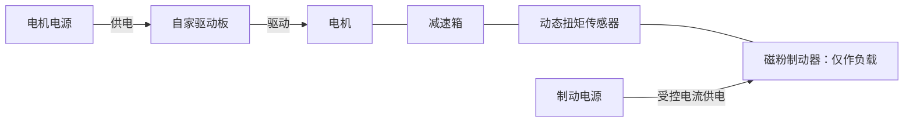
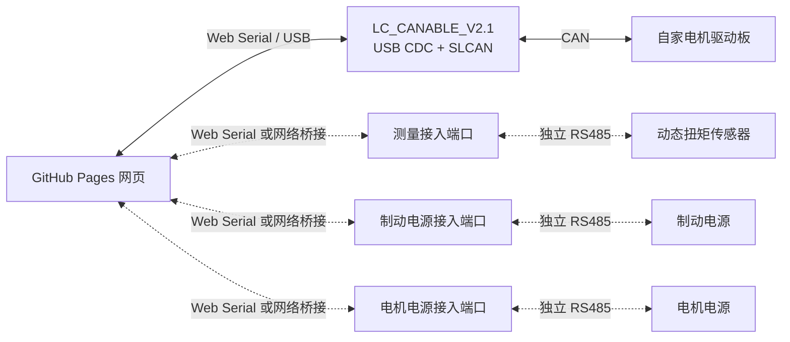

# 试验台设备与接入方案

更新：2026-10-09。设备清单来自用户描述；接入方案为设计建议，尚未联机验证。当前确认项、模拟验收与实机待办统一见[需求基线与本轮检查](requirements-review.md)。

最新补充：机械链已确定为 **电机 → 减速箱 → 动态扭矩传感器 → 磁粉制动器**，制动器只提供负载。**电机电源和制动电源是同类型的两台独立电源**，分别给电机驱动侧和制动线圈供电；制动电源通过电流调节加载。通信已确定为 **三路独立 RS485 + 一路独立 CAN**：传感器、制动电源、电机电源各占一条 RS485 通道，不共用总线。CAN 适配器为鹿小班 **LC_CANABLE_V2.1**，采用 USB CDC/SLCAN 方案；适配器层和首轮能力范围见 [CAN 接口约定 v1](can-interface-contract.md)。两电源的具体型号、协议版本、额定参数与功能能力，以及网关型号和协议仍待确认。

## 已知设备与待定关系

| 设备           | 用户已明确的信息                                                | 仍待确认                                                      |
| -------------- | --------------------------------------------------------------- | ------------------------------------------------------------- |
| 动态扭矩传感器 | 两个，50 N·m 和 100 N·m；位于减速箱输出端与制动器之间           | 转速配置、实际串口参数、设备编号与台架配对、24 V 辅助供电来源 |
| 磁粉制动器     | 两个，50 N·m 和 100 N·m，尺寸不同；只作负载，由电源控制电流加载 | 线圈允许电流与电压、台架配对                                  |
| 制动电源及网关 | 与电机电源同类型；直接驱动制动器，可采用网口转 RS485 接入       | 具体型号、协议版本、额定参数、恒流及反馈能力；网关型号与协议  |
| 电机电源       | 与制动电源同类型；独立给电机驱动侧供电，占用独立 RS485 通道     | 具体型号、协议版本、额定参数、网关接入及可读取或控制的功能    |
| 被测动力总成   | 自家电机、减速箱、驱动板                                        | 减速比、驱动板固件和协议、数量与台架配对                      |
| 电机通信       | CAN；LC_CANABLE_V2.1，可修改固件                                | 当前固件、驱动板速率/帧类型、命令与反馈定义                   |

尚不确定是两套独立试验台，还是同一台架更换组件；也未确定是否需要同时运行两套。50/100 N·m 先作为两种配置候选，不擅自假定设备已经配好或能同时连接。

已确认的机械链与两路供电关系如下：

机械连线表示轴系关系。传感器直接测得的是**减速箱输出扭矩**，不是电机轴扭矩；跨轴估算还需减速比、传动效率等条件，不直接把这两个量等同。

图中两路电源分别表示电机驱动供电与制动线圈供电。EVG-D200 手册另要求传感器使用 DC 24 V、约 0.2 A 的辅助供电；实际取电来源及其与两路电源开关的关系尚待确认。这是接线登记项，当前不增加第三个可控电源或网页角色。

## 四个设备角色分别设计

1. **测量通道**：EVG-D200 的 RS485，提供减速箱输出扭矩及转速。延续已有协议笔记，先验证 Modbus。
2. **电机通道**：驱动板 CAN；哪些模式、设定值、反馈和故障信息可用，要以自家协议为准。不套用其他项目的电机报文。
3. **加载通道**：网页设定制动电源的输出电流，由电源驱动磁粉制动器；实测扭矩由独立传感器提供。
4. **电机供电通道**：独立 RS485，原型只预留供电电压/电流读回，显示“— / 待协议确认”；读取或控制哪些功能需另行确认，当前没有电压设定、限流或输出开关。

RS485 是物理接口，不能据此断定两电源采用 Modbus RTU；需手册确认帧格式、地址、单位与支持能力。[Modbus 串行规范的分层说明](https://www.modbus.org/docs/Modbus_over_serial_line_V1.pdf)。GitHub Pages 继续作为网页部署目标；CAN 经 Web Serial，RS485 设备按适配器或网关能力接入，尚未完成实机联调。

### 通信接入关系（三路 RS485 各自独立）

三个 RS485 端口各自连接对应设备，不共用 A/B 总线。可使用独立适配器，也可使用提供多路独立 RS485 端口的网关；网关数量与型号尚未确定。传感器保留 USB-RS485 接入方案，电源保留网口转 RS485 方案，网页接口可内置于网关，也可由电脑或台架侧服务提供。接入实现时分别管理各通道的连接、串口参数、请求队列、轮询和超时，不使用一条共享 RS485 总线的统一轮询。双套并发需求仍待确认。

### 网口转 RS485 的网页接入条件

普通 GitHub Pages 网页不能直接建立原始 TCP/UDP 连接；Chrome 的 Direct Sockets 面向另行安装的 Isolated Web Apps，不是静态网页默认能力。[Chrome Direct Sockets 文档](https://developer.chrome.com/docs/iwa/direct-sockets)。据此区分以下路线：

| 网关能力                                           | 本项目接入方式                                                                                         |
| -------------------------------------------------- | ------------------------------------------------------------------------------------------------------ |
| 提供用于串口收发或设备控制的 HTTP / WebSocket 接口 | 可评估网页直连，需验证接口、站点授权、HTTPS 页面访问本地网络的浏览器策略；有网页配置页不等于有控制 API |
| 仅支持 TCP 透明传输或 Modbus TCP                   | 通过本机或台架侧桥接服务转换成网页可调用接口；桥接服务不部署在 GitHub Pages                            |
| 改用 USB-RS485 直连电源                            | 可选备用路线，经 Web Serial 接入，仍需实现电源协议                                                     |

TCP 透明传输与 Modbus TCP 转 RTU 是不同工作模式，按网关手册选择；不能把串口帧直接当成 Modbus TCP 请求。HTTP/WebSocket 路线也需在实际 Chrome/Edge 环境验证本地网络权限及相关访问限制。[Chrome 本地网络访问说明](https://developer.chrome.com/blog/local-network-access)。

### 电源控制边界

两台电源按“通用电源接入模块 + 两个独立设备实例”设计；具体协议确认后复用兼容的协议适配器。每个实例分别保存 RS485 连接、设备地址、通信参数、设定、反馈、故障状态和额定上限，各自管理请求与超时；电机供电和制动加载仍使用不同角色入口。同类型不代表型号、协议版本或额定功率一致，复用软件模块也不合并两条 RS485 总线。

制动加载设定以安培（A）为单位，原型已有模拟电流设定与输出开关；真实接入时，实际电流、电压、恒流/恒压状态和故障信息仅在电源协议支持时显示。区分希望设置的值、电源读回的设定值和实际输出，通信写入完成不等于输出已经达到目标。连接及重连不自动开启输出或恢复旧加载值。

制动电源需具备适合该线圈的恒流控制能力；核对电流设定究竟控制输出电流还是仅设置限流值，并登记允许电流及电压上限。50/100 N·m 是机械规格，不能推算线圈额定电流，也不把电流设定直接换算为已达到的扭矩。首版不自动闭环追踪目标扭矩。

电机供电的设计侧重点是供电电压与限流；是否支持设定、输出开关和反馈，以及网页开放哪些功能，需结合电源手册确认。当前只提供读回占位，不改变已有模拟电机、传感器和制动电源的动作，也不新增供电联锁假设。未来读回的“电机供电电流”必须与制动电流、电机相电流分别命名；电源读数不直接当作相电流或电机轴扭矩。

### CAN 接入形态

CAN 固件只解决 CAN 与 USB 的转换，不能仅靠刷固件让 CAN 收发器直接接 RS485；RS485 路径仍需相应接口硬件。

| CAN 接入形态                              | 网页方案                                                           |
| ----------------------------------------- | ------------------------------------------------------------------ |
| 操作系统识别为串口，具有已知 CAN 封装协议 | 可评估 Web Serial；网页编解码适配器帧和驱动板报文两层协议          |
| Linux SocketCAN，例如 `can0`              | 通过本机网关接入；网页不能把 `can0` 当串口打开                     |
| 厂商 USB 协议或 SDK                       | 视协议、驱动占用及浏览器支持评估 WebUSB 或本机网关，不能保证免安装 |

Web Serial 访问系统串口或模拟串口设备；SocketCAN 是 Linux CAN 网络接口；WebUSB 则提供 USB 设备访问能力。上述分支是根据这些接口能力作出的工程判断，具体适配器仍需验证。[Web Serial](https://developer.chrome.com/docs/capabilities/serial)、[SocketCAN](https://docs.kernel.org/networking/can.html)、[WebUSB](https://developer.mozilla.org/en-US/docs/Web/API/WebUSB_API)。

### 本地已有项目的可复用部分

- 鹿小班 CANable 实验固件（工作区参考：`engineering/realman/firmware/README.md`） 和对应 USB CDC 实现（工作区参考：`engineering/realman/firmware/work/canable2-whj/src/usbd_cdc_if.c`）、SLCAN 实现（工作区参考：`engineering/realman/firmware/work/canable2-whj/src/slcan.c`） 可作为浏览器直连的源码基础。该工程已做特定板级引脚适配和 WHJ CAN 时序修改；其记录仍有连续通信错误，不能直接视为本台架验证通过的通用固件。
- CAN Workbench（工作区参考：`engineering/can-workbench/README.md`） 当前支持 LC_CANABLE_V2.1、Candlelight、Linux `gs_usb` / `can0`。它提供同板型的历史接入参考，帧校验、连接状态、模拟模式及传输抽象可参考；其固件状态和总线速率不视为本次试验台的已确认值。
- 服务端实现（工作区参考：`engineering/can-workbench/can_workbench/server.py`） 当前只允许本机同源请求并校验会话令牌。GitHub Pages 页面不能直接复用现有 API；若选网关路线，需要另行设计站点授权与浏览器连接，不直接移除现有保护。
- 达妙 USB-CAN 笔记（工作区参考：`engineering/robotics/docs/damiao-usb-can.md`） 记录了另一种串口 CAN 封装，但该文档也注明实机未验证。仅作为适配器实现参考，不代表本次电机或转接器型号。

以上项目均未修改，也未配置或访问真实 CAN 硬件。

### CAN 固件与网页的最小配合

采用已有 SLCAN 帧格式作为起点，无需立即自创一套完整 CAN 封装。上游支持经典 CAN、扩展 ID 和带扩展命令的 CAN FD，但配置命令没有 ACK/NACK；网页不能把串口写入完成当成配置成功或电机执行成功。[CANable 固件上游](https://github.com/normaldotcom/canable2-fw)。

后续按实际板型准备固件时，优先明确：

- USB 设备身份、板型和固件版本；界面将通信端点绑定到“电机驱动板 / 动态扭矩传感器 / 制动电源 / 电机电源”角色，不能只靠端口出现顺序。
- 可用 CAN 模式、波特率和配置回读，避免继承其他项目的 WHJ 专用时序。
- 接收分帧、发送队列、溢出计数与 CAN 错误状态；区分主机提交、总线发送结果和驱动板响应。
- 默认不发送电机控制帧，断开及重连不重放旧目标；通信超时动作按自家驱动协议设计，不能只停止网关发帧就宣称电机已停机。
- 必要时加入适配器接收时间戳和序号，但它们不等于传感器内部采样时间，也不能直接当作多个适配器的同步时钟。

当前为接口设计阶段，固件实现与实机验证待完成。

## 面向使用者的界面调整

建议用户先选择已登记的台架/设备组合，再查看四个设备角色的接入状态。首页仍只突出常用流程：**选择配置 → 连接 → 设定试验条件 → 观察 → 记录与导出**。当前原型保留三个原有角色的模拟操作，电机电源显示待接入。

本轮在模拟原型中完成正负扭矩曲线、记录相对时间、配置与事件保存、三指标历史回看、数据缺失统计及本地保存保护；加入全局输出/记录摘要，保留断线状态并持续提醒，区分输入草稿与已应用设定，改善对比度和手机按钮。逻辑测试 20/20、浏览器流程、构建及生产 preview 的 8 组需求流程均通过，范围见[模拟验收矩阵](requirements-review.md#模拟可验收)与[验证记录](requirements-review.md#6-本轮验证记录)。按用户意见不再使用 Shaders 或装饰动效。

- 50/100 N·m 配置保存实际传感器标识、量程、减速比、端口绑定和设备约束。切换配置不改传感器标定系数，也不把显示量程变化当成物理量程变化。
- 分别显示各通道的连接与数据状态，不能用一个“已连接”掩盖另一条通道失联。
- 主要区域是“减速箱输出扭矩”、输出转速、曲线和记录；CAN 设定/反馈按协议逐项加入，缺少反馈时不伪造状态。
- 电机侧转速、减速箱输出转速、CAN 中可能存在的估算扭矩、传感器实测输出扭矩分别命名；跨轴换算所需条件未确认前不做换算。
- 加载区并列显示“制动目标电流（A）”“实际制动电流（A）”及减速箱输出扭矩；无电源读回时实际电流显示“—”。输出开关同时区分待执行与已确认状态。
- 设置抽屉中的“电机供电”只预留电压（V）与供电电流（A），当前显示“— / 待协议确认”，不提供模拟连接或控制功能；主界面保持三张读数卡和两组控制。
- “停止记录”“关闭制动电源输出”和“停止电机”分别命名。电源输出关闭不等于轴系已经停转或实测扭矩为零。连接成功或重连不自动使能电机、不恢复运动设定。
- 本轮新增的“停止全部模拟输出”只用于关闭模拟电机和制动输出，继续保留记录；该入口不代表硬件急停，不新增电机电源控制或真实停机联锁。

50/100 N·m 是设备规格信息，不能直接当作整套轴系的允许试验上限。运行约束应由实际电机、减速箱、传感器、加载装置及装配共同确认，缺失项保留待定。

## 记录与控制职责

后续真实采集按试验保存配置快照、各通道原始数据、电脑接收时间和操作事件，包括制动电流设定、实际制动电流读回（若可用）及制动输出开关结果；电机供电读回按最终功能范围加入。曲线可在同一时间轴显示，但不同通道的采样/通信延迟不同；没有共同硬件时钟前，不宣称各通道硬件同步。

本轮已验证模拟记录的配置快照、事件归属、统一相对时间与数据/事件导出；旧记录缺少的配置或事件保留为未知。历史支持三指标与缺失点统计，不足 10 秒的窗口显示小数秒。支持 Web Locks 时合并多标签页保存，无锁时提示使用单个页面；损坏原值受到保护，其他页面清除存储后保留内存记录并提示尚未保存。

活动记录恢复和长期增量存储尚未实现，每场模拟记录继续限制为 1500 点。已通过 Playwright 模拟时钟验证达到上限后结束并保存记录，输出继续保持原状态；这一结果不代表实机或长时性能验收。真实清零/滤波、自动恒扭矩和 GitHub Pages 发布仍未完成。

网页负责试验操作、可视化和记录。电机实时控制、通信超时后的行为及必要联锁应在驱动板/本机控制层确认；浏览器计时和网页退出事件不作为实时控制保证。现有 CAN Workbench 的页面心跳仅管理周期发送，不能视为已实现电机停机。

自动恒扭矩加载、扫速曲线、效率计算等需要额外控制或测量条件，不从当前设备描述直接纳入已支持能力。先完成测量采集、CAN 通信与手动电流设定，再根据实机验证决定扩展范围。

## 下一步需确认

1. 两种量程的设备组合、是否同时运行；机械链顺序已经确认。
2. 两台同类型电源各自的具体型号、协议版本、额定参数和功能能力；电机供电电压/限流/输出及反馈能力、制动电源恒流能力与反馈、两种制动器线圈的允许电流及电压；网口转 RS485 网关型号、协议与独立端口分配。
3. 当前 CAN 固件、驱动板协议资料位置、总线参数及减速比；板型已确认，无需再次询问。
4. 传感器所需 24 V 辅助供电来源、转速版本、测试电脑环境与所需数据速度。

工作区参考说明：以上 `engineering/realman/`、`engineering/can-workbench/`、`engineering/robotics/` 为研读时的其他本地项目路径，未包含在本仓库中；本仓库可独立克隆阅读，相关实现结论需在后续移植时重新验证。
