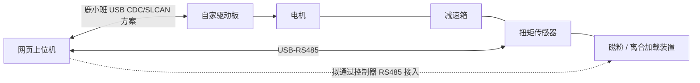
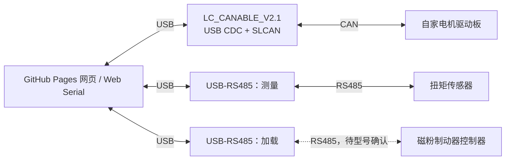

# 试验台设备与接入方案

更新：2026-10-08。设备清单来自用户描述；接入方案为设计建议，尚未联机验证。

最新补充：CAN 适配器已确认是鹿小班 **LC_CANABLE_V2.1**，可根据方案修改固件；用户表示制动器通常也使用 RS485，但尚未给出本机控制器型号和协议。主方案优先采用浏览器直连：一条 USB CDC/SLCAN CAN 通道，加两条独立 USB-RS485 通道。适配器层和首轮 CAN 能力范围已写入 [CAN 接口约定 v1](can-interface-contract.md)。

## 已知设备与待定关系

| 设备 | 用户已明确的信息 | 仍待确认 |
| --- | --- | --- |
| 扭矩传感器 | 两个，50 N·m 和 100 N·m | 转速配置、实际串口参数、各自安装位置与编号 |
| 磁粉/离合装置 | 两个，50 N·m 和 100 N·m，尺寸不同；用户后续称制动器，控制器暂按 RS485 预留 | 具体控制器型号、是否确为 RS485、命令及寄存器定义 |
| 被测动力总成 | 自家电机、减速箱、驱动板 | 减速比、驱动板固件和协议、数量与台架配对 |
| 电机通信 | CAN；LC_CANABLE_V2.1，可修改固件 | 当前固件、驱动板速率/帧类型、命令与反馈定义 |

尚不确定是两套独立试验台，还是同一台架更换组件；也未确定是否需要同时运行两套。50/100 N·m 先作为两种配置候选，不擅自假定设备已经配好或能同时连接。

按用户描述，暂理解传感器位于减速箱输出端与磁粉装置之间，最终以装配关系确认：

图中机械连线表示轴系关系，未指定具体离合器另一端的约束方式。不能仅根据“磁粉/离合”推定为固定外壳的磁粉制动器。

## 三条通道分别设计

1. **测量通道**：EVG-D200 的 RS485，提供实测扭矩及转速。延续已有协议笔记，先验证 Modbus。
2. **电机通道**：驱动板 CAN；哪些模式、设定值、反馈和故障信息可用，要以自家协议为准。不套用其他项目的电机报文。
3. **加载通道**：根据用户补充，暂按磁粉控制器 RS485 接入设计，实际型号未确认。RS485 是物理接口，不能据此断定采用 Modbus RTU；需控制器手册确认帧格式、地址、控制量及单位、允许范围、反馈与停止方式。若当前仍是旋钮手动加载，网页先记录人工设定并显示实测响应。[Modbus 串行规范的分层说明](https://www.modbus.org/docs/Modbus_over_serial_line_V1.pdf)。

GitHub Pages 继续作为网页部署目标。已确定采用 LC_CANABLE_V2.1 的 USB CDC 串口固件路线，实现三通道 Web Serial 接入；控制器协议和实机兼容性仍待验证，并非已经完成免本机服务联调。

### 推荐接线方案

以上按一次使用一套设备画出通道，不代表双套并发需求已确定。第一版将测量与加载使用独立 RS485 通道，便于分别配置速率、管理请求和诊断，同时保留扭矩传感器高速主动上传的拓展空间。若以后合并到同一 RS485 总线，需确认兼容的电气连接、通信格式、唯一从站地址及统一轮询；主动上传模式不直接并入正在轮询其他设备的总线。

CAN 固件只解决 CAN 与 USB 的转换，不能仅靠刷固件让 CAN 收发器直接接 RS485；RS485 路径仍需相应接口硬件。

| CAN 接入形态 | 网页方案 |
| --- | --- |
| 操作系统识别为串口，具有已知 CAN 封装协议 | 可评估 Web Serial；网页编解码适配器帧和驱动板报文两层协议 |
| Linux SocketCAN，例如 `can0` | 通过本机网关接入；网页不能把 `can0` 当串口打开 |
| 厂商 USB 协议或 SDK | 视协议、驱动占用及浏览器支持评估 WebUSB 或本机网关，不能保证免安装 |

Web Serial 访问系统串口或模拟串口设备；SocketCAN 是 Linux CAN 网络接口；WebUSB 则提供 USB 设备访问能力。上述分支是根据这些接口能力作出的工程判断，具体适配器仍需验证。[Web Serial](https://developer.chrome.com/docs/capabilities/serial)、[SocketCAN](https://docs.kernel.org/networking/can.html)、[WebUSB](https://developer.mozilla.org/en-US/docs/Web/API/WebUSB_API)。

### 本地已有项目的可复用部分

- 鹿小班 CANable 实验固件（工作区参考：`engineering/realman/firmware/README.md`） 和对应 USB CDC 实现（工作区参考：`engineering/realman/firmware/work/canable2-whj/src/usbd_cdc_if.c`）、SLCAN 实现（工作区参考：`engineering/realman/firmware/work/canable2-whj/src/slcan.c`） 可作为浏览器直连的源码基础。该工程已做特定板级引脚适配和 WHJ CAN 时序修改；其记录仍有连续通信错误，不能直接视为本台架验证通过的通用固件。
- CAN Workbench（工作区参考：`engineering/can-workbench/README.md`） 当前支持 LC_CANABLE_V2.1、Candlelight、Linux `gs_usb` / `can0`。它提供同板型的历史接入参考，帧校验、连接状态、模拟模式及传输抽象可参考；其固件状态和总线速率不视为本次试验台的已确认值。
- 服务端实现（工作区参考：`engineering/can-workbench/can_workbench/server.py`） 当前只允许本机同源请求并校验会话令牌。GitHub Pages 页面不能直接复用现有 API；若选网关路线，需要另行设计站点授权与浏览器连接，不直接移除现有保护。
- 达妙 USB-CAN 笔记（工作区参考：`engineering/robotics/docs/damiao-usb-can.md`） 记录了另一种串口 CAN 封装，但该文档也注明实机未验证。仅作为适配器实现参考，不代表本次电机或转接器型号。

以上项目均未修改，也未配置或访问真实 CAN 硬件。

### CAN 固件与网页的最小配合

采用已有 SLCAN 帧格式作为起点，无需立即自创一套完整 CAN 封装。上游支持经典 CAN、扩展 ID 和带扩展命令的 CAN FD，但配置命令没有 ACK/NACK；网页不能把串口写入完成当成配置成功或电机执行成功。[CANable 固件上游](https://github.com/normaldotcom/canable2-fw)。

后续按实际板型准备固件时，优先明确：

- USB 设备身份、板型和固件版本；界面将端口绑定到“电机 / 测量 / 加载”角色，不能只靠端口出现顺序。
- 可用 CAN 模式、波特率和配置回读，避免继承其他项目的 WHJ 专用时序。
- 接收分帧、发送队列、溢出计数与 CAN 错误状态；区分主机提交、总线发送结果和驱动板响应。
- 默认不发送电机控制帧，断开及重连不重放旧目标；通信超时动作按自家驱动协议设计，不能只停止网关发帧就宣称电机已停机。
- 必要时加入适配器接收时间戳和序号，但它们不等于传感器内部采样时间，也不能直接当作多个适配器的同步时钟。

当前为接口设计阶段，固件实现与实机验证待完成。

## 面向使用者的界面调整

建议用户先选择已登记的台架/设备组合，再连接传感器、电机和可用的加载控制器。首页仍只突出常用流程：**选择配置 → 连接 → 设定试验条件 → 观察 → 记录与导出**。

- 50/100 N·m 配置保存实际传感器标识、量程、减速比、端口绑定和设备约束。切换配置不改传感器标定系数，也不把显示量程变化当成物理量程变化。
- 分别显示各通道的连接与数据状态，不能用一个“已连接”掩盖另一条通道失联。
- 主要区域是实测输出扭矩、输出转速、曲线和记录；CAN 设定/反馈按协议逐项加入，缺少反馈时不伪造状态。
- 电机侧转速、减速箱输出转速、CAN 中可能存在的估算扭矩、传感器实测扭矩分别命名。减速比未确认前不做跨轴换算。
- 负载设定值与传感器实测扭矩分别显示；只有真实反馈才能标记为已达到或已执行。
- “停止记录”和“停止电机”是不同操作，需分开命名。连接成功或重连不自动使能电机、不恢复运动设定。

50/100 N·m 是设备规格信息，不能直接当作整套轴系的允许试验上限。运行约束应由实际电机、减速箱、传感器、加载装置及装配共同确认，缺失项保留待定。

## 记录与控制职责

一次试验保存配置快照、来自各通道的原始数据、电脑接收时间和操作事件。曲线可在同一时间轴显示，但不同通道的采样/通信延迟不同；没有共同硬件时钟前，不宣称两条数据流硬件同步。

网页负责试验操作、可视化和记录。电机实时控制、通信超时后的行为及必要联锁应在驱动板/本机控制层确认；浏览器计时和网页退出事件不作为实时控制保证。现有 CAN Workbench 的页面心跳仅管理周期发送，不能视为已实现电机停机。

自动恒扭矩加载、扫速曲线、效率计算等需要额外控制或测量条件，不从当前设备描述直接纳入已支持能力。先完成双通道正确采集，再根据实际接口决定控制范围。

## 下一步需确认

1. 两种量程的设备组合、是否同时运行、实际轴系连接。
2. 制动器控制器型号及 RS485 协议、设定量的含义与单位。
3. 当前 CAN 固件、驱动板协议资料位置、总线参数及减速比；板型已确认，无需再次询问。

工作区参考说明：以上 `engineering/realman/`、`engineering/can-workbench/`、`engineering/robotics/` 为研读时的其他本地项目路径，未包含在本仓库中；本仓库可独立克隆阅读，相关实现结论需在后续移植时重新验证。
